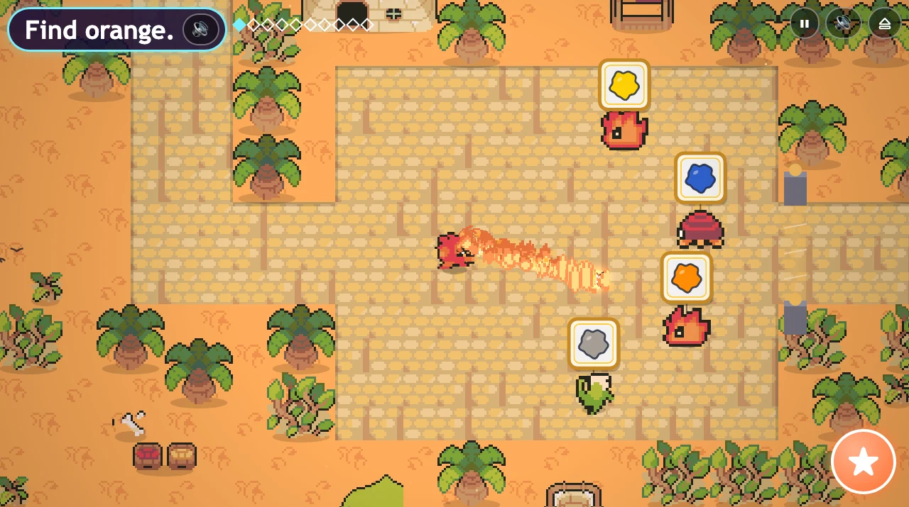
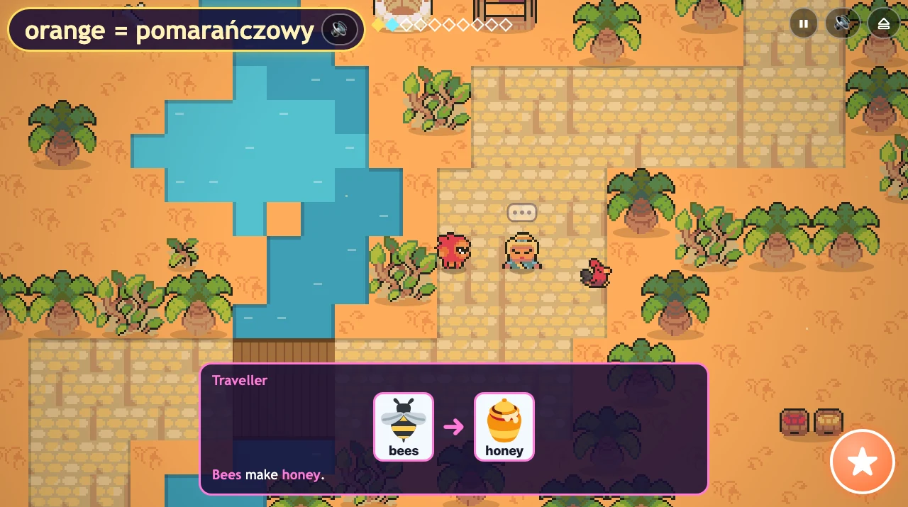
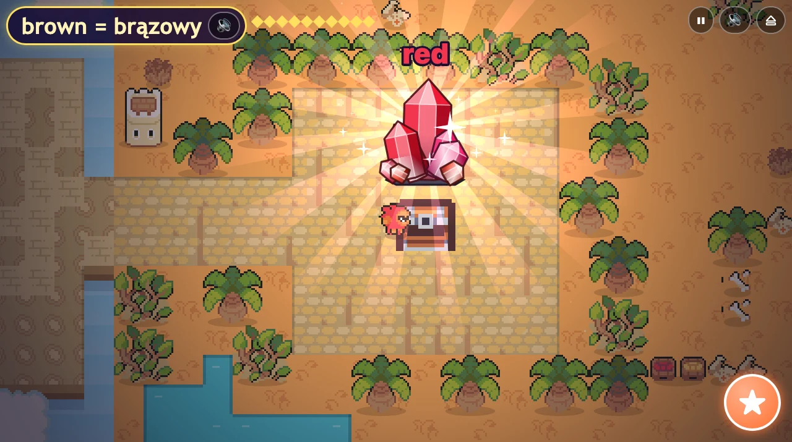
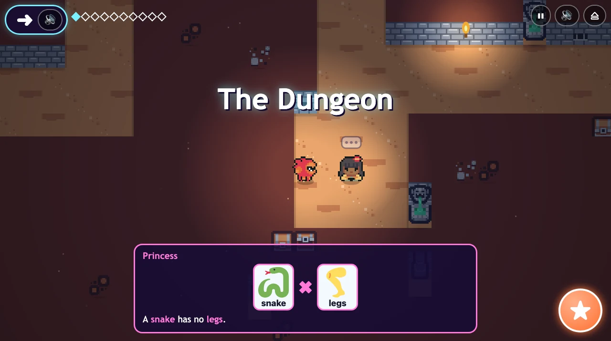
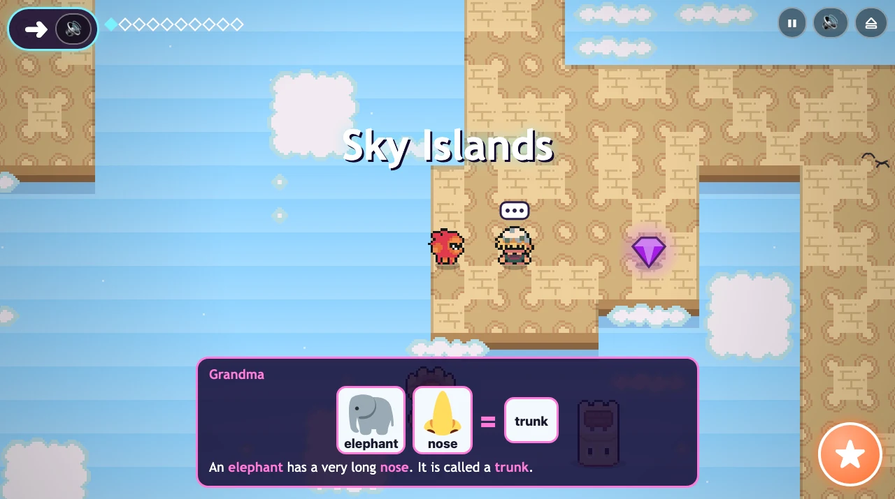
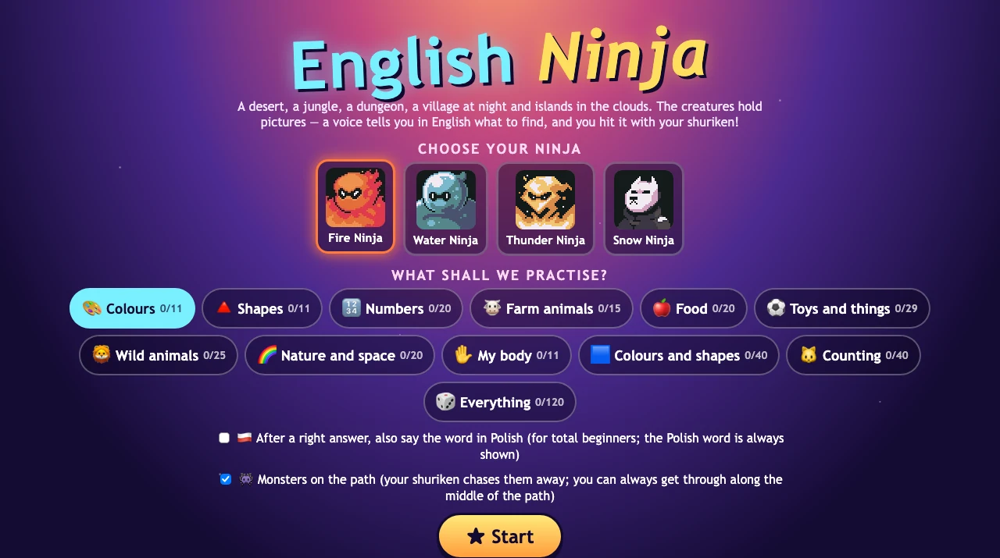

# English Ninja

Play online: <https://akandr.cc/english_ninja/>

A game for children learning their first English words. A ninja travels through
a desert, a jungle, a dungeon, a village at night and islands in the clouds.
The creatures hold pictures; a voice says in English what to find, and you hit
the right one with your shuriken. Storytellers on the way tell very simple facts
(with pictures), and a crystal waits in the treasure chest at the end.



<p>
  
  
  
  
  
</p>

Categories: colours, shapes, numbers, farm animals, food, toys and things, wild
animals, nature and space, my body, colours and shapes, counting.

Sister games: [Sylabowy Ninja](https://github.com/akandr/SylabowyNinja) (Polish syllables)
and [Liczbowy Ninja](https://github.com/akandr/LiczbowyNinja) (counting).

## Controls

- Arrows / WASD or drag your finger — walk
- Space (or tap the screen / the ★ button) — throw a shuriken
- H — hear the word again
- P — pause

## Running locally

It is a static page with no build step. Any HTTP server in the repository folder will do:

```sh
python3 -m http.server 8000
# http://localhost:8000/
```

## Licenses

- **Game code**: © 2026 Artur Andrzejczak, [GNU AGPL v3](LICENSES/AGPL-3.0.txt).
  Made with the help of Claude (Anthropic).
- **Ninjas, creatures, desert, jungle, music, sounds, elemental effects**:
  [Ninja Adventure Asset Pack](https://pixel-boy.itch.io/ninja-adventure-asset-pack)
  (Pixel-boy & AAA), CC0 1.0.
- **Dungeon, night village, sparks and stars**: [Kenney](https://kenney.nl)
  (Tiny Dungeon, Tiny Town, Particle Pack), CC0 1.0.
- **Word and fact pictures** in `img/`: [Twemoji](https://github.com/jdecked/twemoji)
  (© Twitter, Inc. and other contributors), CC-BY 4.0; `hex.svg` is our own.
- **Voice clips** in `audio/`: generated with Microsoft Edge text-to-speech
  (neural voices Sonia, Ava, Andrew; Polish words: Zofia). They are not covered
  by the AGPL or a Creative Commons license.

See [LICENSE](LICENSE) for details.
